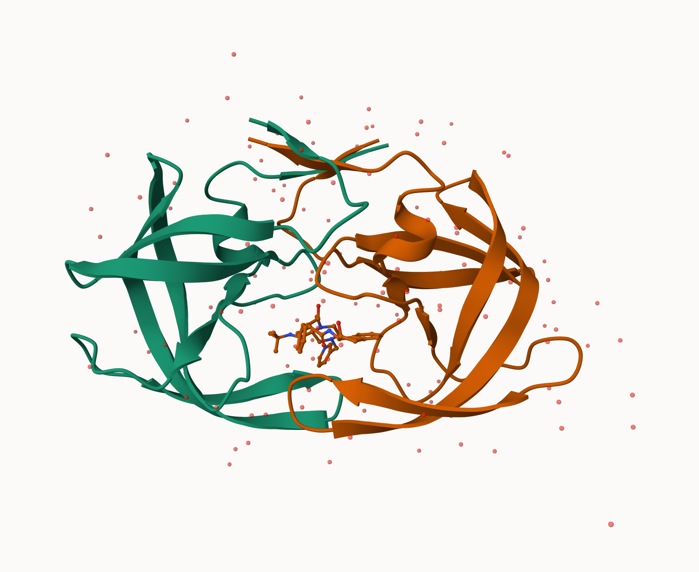
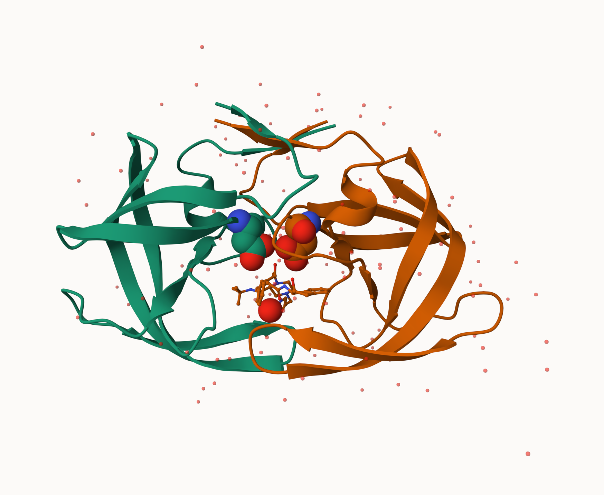

## Background

The [PDB database](https://www.rcsb.org/) is the main repository of biomolecular structure information. Let's have a look at the composition of this database:

Visit PDB and click: Analyze \> PDB statistics \> Experimental Method \> Summary

We can "scrape" data from theis page with the **datapasta** package that we can install from CRAN `install.packages("datapasta")`

Then "Addins \> PAste as data.frame":

```{r, echo=FALSE}
pdb <- data.frame(
  stringsAsFactors = FALSE,
       check.names = FALSE,
           Molecular.Type = c("Protein (only)",
                              "Protein/Oligosaccharide","Protein/NA",
                              "Nucleic acid (only)","Other","Oligosaccharide (only)",
                              "Total"),
              Xray = c(184731, 10716, 9341, 3216, 178, 11, 208193),
                EM = c(25754, 4037, 7520, 347, 27, 1, 37686),
               NMR = c(12904, 34, 288, 1599, 35, 6, 14866),
       Integrative = c(365L, 8L, 27L, 3L, 4L, 0L, 407L),
  Multiple.methods = c(232L, 11L, 8L, 15L, 0L, 1L, 267L),
           Neutron = c(86L, 1L, 0L, 3L, 0L, 0L, 90L),
             Other = c(32L, 0L, 0L, 1L, 0L, 4L, 37L),
             Total = c(224104, 14807, 17184, 5184, 244, 23, 261546)
       )
```

```{r}
pdb
```

> Q1.What percentage of structures in the PDB are solved by X-Ray and Electron Microscopy.

```{r}
sum(pdb$Xray) / sum(pdb$Total) * 100
sum(pdb$EM)   / sum(pdb$Total) * 100
```

About 79.60% of structures are X-ray and about 14.40% are EM.

> Q2: What proportion of structures in the PDB are protein?

```{r}
pdb$Total[1] / pdb$Total[7] * 100
```

About 85.68% of the structures in the PDB are protein.

> Q3: Type HIV in the PDB website search box on the home page and determine how many HIV-1 protease structures are in the current PDB?

There were 1,198 Structure.

## The Mol-star viewer

This viewer is embedded into many never bioinformatics databases including the PDB and UniProt. The viewer is also accessible from it's homepage: https://molstar.org



HIV-Protease (or HIV-Pr for short) is a critical HIV enzyme required for virus replication. It is an Aspartal protease, which means it use Asp amino acid residues to cleave chiral proteins




> Q4: Water molecules normally have 3 atoms. Why do we see just one atom per water molecule in this structure?

Hydrogen atoms are too small to be seen at this structure’s resolution, so only the oxygen of each water molecule shows up.

> Q5: There is a critical “conserved” water molecule in the binding site. Can you identify this water molecule? What residue number does this water molecule have

The conserved water is HOH 308. It sits in the binding site and bridges the protease flaps to the indinavir ligand.

> Q6: Generate and save a figure clearly showing the two distinct chains of HIV-protease along with the ligand. You might also consider showing the catalytic residues ASP 25 in each chain and the critical water (we recommend “Ball & Stick” for these side-chains). Add this figure to your Quarto document. Discussion Topic: Can you think of a way in which indinavir, or even larger ligands and substrates, could enter the binding site?

Proteins aren’t rigid. They move. The flaps are flexible and can swing open, letting the drug or substrate slip into the pocket. Once it’s inside, the flaps close back down over it and hold it in place. The crystal structure is just one snapshot of the flaps in the closed position.

## Bio3D in R

The **Bio3d** package is for structural bioinformatics and allows us to read structural data and perform bioinformatics analysis all within R itself:

```{r}
library(bio3d)

hiv <-read.pdb("1hsg")
```

```{r}
hiv
```

```{r}
pdbseq(hiv)
```

### Quick structure viz in R

We can use the new **bio3d.view** package to more easily view structures quickly in R:

```{r}
library(bio3dview)
```

```{r}
view.pdb(hiv)
```

```{r}
# select our two ASP 25 amino acids
asp <-atom.select(hiv, resno=25)

## Draw them highlighted in spacefill
view.pdb(hiv,
         cols=c("navy","teal"),
         highlight = asp,
         highlight.style = "spacefill",
         backgroundColor= "black")
      
```

> Q7: How many amino acid residues are there in this pdb object?

There are 198 amino acid residues.

> Q8: Name one of the two non-protein residues?

The two non-protein residues are HOH (water, 127 of them) and MK1 (indinavir, the drug).

> Q9: How many protein chains are in this structure?

There are 2 protein chains, A and B.

## Predict the dynamics of ADK

Let's read a new pdb structure of Adenylate Kinase and perform normal mode analysis

```{r}
adk <- read.pdb("6s36")
m <- nma(adk)
plot(m)
```

Also make a little molecular moview (trajectory) for viewing in Mol-star

```{r}
mktrj(m, file="adk_dynamics.pdb")
```

```{r}
view.nma(m)
```

## Comparative structure analysis of Adenylate Kinase

### Background Here we complete Lab 9, section 5, all about comparative analysis of protein structures

### Setup

load the packages we need for our full analysis:

```{r}
library(ggplot2)
library(bio3d)
```

### Analysis pipeline

The main input will be a single database ID (accession number). We can change this in the future to run our analysis on any protein family.

```{r}
id <- "1ake_A"
```

We will begin by first installing the packages we need for today’s session. Note that if you have followed along with the previous sections then you will already have all but the last of these (i.e. you will just need to install the msa package).

> Q10. Which of the packages above is found only on BioConductor and not CRAN?

msa. It’s installed with `BiocManager::install()`, which installs from Bioconductor.

> Q11. Which of the above packages is not found on BioConductor or CRAN?:

It’s installed from GitHub with `remotes::install_github("bioboot/bio3dview")`, so it isn’t on CRAN or Bioconductor.

> Q12. True or False? Functions from the pak package can be used to install packages from GitHub and BitBucket?

TRUE

### Search and retrieve ADK structures

Below we perform a blast search of the PDB database to identify related structures to our query Adenylate kinase (ADK) sequence. In this particular example we use function get.seq() to fetch the query sequence for chain A of the PDB ID 1AKE and use this as input to blast.pdb(). Note that get.seq() would also allow the corresponding UniProt identifier.

```{r}
library(bio3d)
aa <- get.seq("1ake_A")
aa
```

> Q13. How many amino acids are in this sequence, i.e. how long is this sequence?

```{r}
length(aa$ali)
```

```{r}
hits <- NULL
hits$pdb.id <- c('1AKE_A','6S36_A','6RZE_A','3HPR_A','1E4V_A','5EJE_A','1E4Y_A','3X2S_A','6HAP_A','6HAM_A','4K46_A','3GMT_A','4PZL_A')
```

```{r}
# Download releated PDB files
files <- get.pdb(hits$pdb.id, path="pdbs", split=TRUE, gzip=TRUE)
```

```{r}
# Align releated PDBs
pdbs <- pdbaln(files, fit = TRUE, exefile="msa")
```

```{r}
library(bio3dview)

view.pdbs(pdbs)
```

```{r}
# Vector containing PDB database codes
ids <- basename.pdb(pdbs$id)

anno <- pdb.annotate(ids)
unique(anno$source)
```

```{r}
anno
```

### Principal Component Analysis

```{r}
# Perform PCA
pc.xray <- pca(pdbs)
plot(pc.xray)
```

```{r}
# Calculate RMSD
rd <- rmsd(pdbs)

# Structure-based clustering
hc.rd <- hclust(dist(rd))
grps.rd <- cutree(hc.rd, k=3)

plot(pc.xray, 1:2, col="grey50", bg=grps.rd, pch=21, cex=1)
```

```{r}
# Visualize first principal component
pc1 <- mktrj(pc.xray, pc=1, file="pc_1.pdb")
```

```{r}
#Plotting results with ggplot2
library(ggplot2)
library(ggrepel)

df <- data.frame(PC1=pc.xray$z[,1], 
                 PC2=pc.xray$z[,2], 
                 col=as.factor(grps.rd),
                 ids=ids)

p <- ggplot(df) + 
  aes(PC1, PC2, col=col, label=ids) +
  geom_point(size=2) +
  geom_text_repel(max.overlaps = 20) +
  theme(legend.position = "none")
```

## Normal mode analysis

```{r}
# NMA of all structures
modes <- nma(pdbs)
```

```{r}
plot(modes, pdbs, col=grps.rd)

```

> Q14. What do you note about this plot? Are the black and colored lines similar or different? Where do you think they differ most and why?

The black and colored lines follow a similar pattern, but the colored lines show greater fluctuations. The biggest differences occur around residues 130–155, likely due to structural differences in flexible regions of the proteins.
